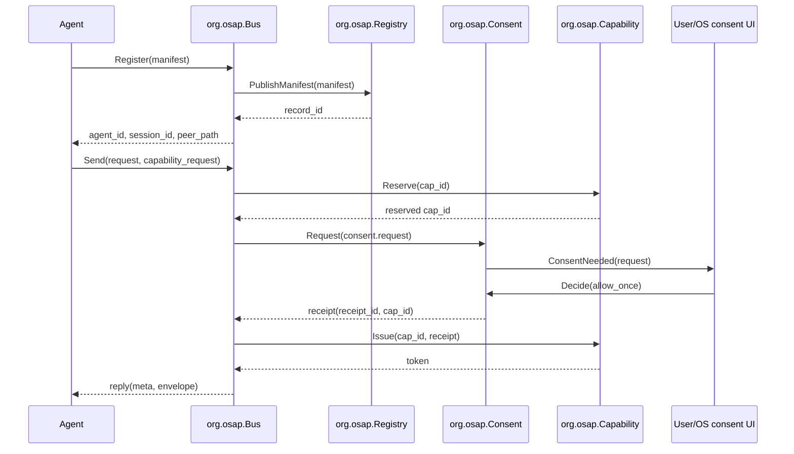
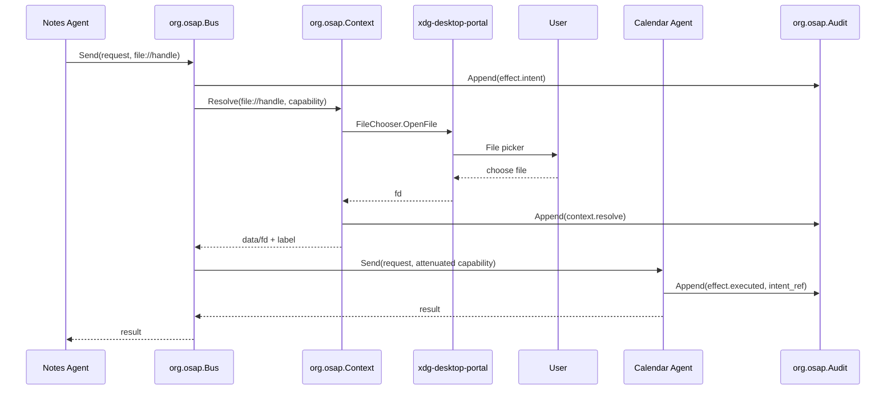
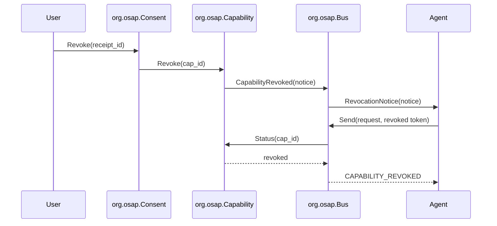

# OSAP Linux Binding Profile

> Status: 0.1 Draft · 2026-11-19
> Normative source: [`docs/standard.md`](../../docs/standard.md) Sections 3.6, 7.10, 9, and 10
> Chinese original: [profile.md](profile.md)
> Scope: Linux desktop, single-user session, D-Bus, and `systemd --user`

This document maps OSAP onto a Linux desktop session. It does **not** change
protocol semantics. It specifies how messages travel over D-Bus, how processes
are managed by `systemd --user`, and how OSAP context handles interoperate with
`xdg-desktop-portal`.

This is not an IETF document, and it does not require every Linux
implementation to use the same transport. An implementation that claims this
profile MUST satisfy the MUST clauses in Sections 2, 3, 5, and 6.

---

## 1. Roles and Process Model

### 1.1 Processes

The 0.1 Linux binding uses five services per user. They are started by
`systemd --user`, run in the same user session, and are not shared across
users.

| Service | D-Bus name | Object path | Responsibility | Persistent state |
|---|---|---|---|---|
| Bus Core | `org.osap.Bus` | `/org/osap/Bus` | Peer authentication, envelope validation, routing, sessions, backpressure | Session and task indexes may be persisted |
| Registry | `org.osap.Registry` | `/org/osap/Registry` | Manifests, capability records, event topics, discovery | Manifests and record cache |
| Policy & Consent | `org.osap.Consent` | `/org/osap/Consent` | Policy evaluation, consent requests and receipts, `cap_id` reservations | Requests, receipts, reservations |
| Capability Authority | `org.osap.Capability` | `/org/osap/Capability` | Issue, attenuate, revoke, and report status | Issued and revoked capabilities |
| Context Fabric | `org.osap.Context` | `/org/osap/Context` | Handle resolution, object references, portal bridge | Handles, labels, events |
| Audit | `org.osap.Audit` | `/org/osap/Audit` | Append-only audit chain, verification, export, archive | Audit chain and archive |

Bus Core MUST NOT evaluate policy, issue capabilities, parse business payloads,
or persist audit bodies. Registry, Consent, Capability, Context, and Audit MUST
run as separate processes or separate sandboxes and MUST NOT share an address
space with Bus Core.

### 1.2 D-Bus Names and Identity

- A service MUST own the well-known name in the table above. The name denotes a
  service, not an agent identity.
- An agent's `agent://` URI MUST be assigned or confirmed by the Bus at
  registration. A D-Bus unique name (`:1.42`) MUST NOT be used as an agent
  identity.
- An agent MAY also own a name such as `org.osap.Agent.<app-id>.<instance>` for
  debugging, but that name MUST NOT participate in authorization decisions.
- The Bus MUST maintain a binding from `agent://` to (D-Bus unique name, pid,
  uid, executable, session) and MUST recheck it on every route.

### 1.3 Object Paths

Fixed service objects use the paths in the table. Dynamic objects use a
Bus-assigned decimal sequence number so that an arbitrary `agent://` string is
never concatenated into an object path:

- Peer: `/org/osap/Bus/Peers/<uint64>`
- Task: `/org/osap/Bus/Tasks/<uint64>`
- Stream: `/org/osap/Bus/Streams/<uint64>`

The `<uint64>` MUST be unique for the lifetime of the Bus. After release, the
Bus SHOULD keep a cooling-off period so that an old message is not misrouted.

---

## 2. Transport Mapping

### 2.1 Session Bus and Direct Socket

This profile defines two paths:

1. **Primary path: the D-Bus session bus.** All services register on the user
   session bus. Agents call services through D-Bus method calls.
2. **Compatibility path: a direct Unix domain socket.** The Bus MAY listen on
   `$XDG_RUNTIME_DIR/osap/bus.sock` for sandboxes or runtimes that cannot use
   D-Bus. The socket MUST be `chmod 0600`, and its parent directory MUST be
   `0700`.

Both paths MUST use the same OSAP envelope, capability checks, and audit logic.
The direct socket is not a back door around D-Bus policy; it MUST enforce the
same peer authentication and quotas.

### 2.2 Peer Authentication

- A D-Bus connection MUST use `EXTERNAL` authentication and MUST NOT accept
  `ANONYMOUS`.
- A service MUST read `uid` and `pid` through
  `org.freedesktop.DBus.GetConnectionCredentials` or equivalent kernel
  credentials and MUST verify `uid == geteuid()`. A call from another uid MUST
  be rejected.
- A service SHOULD read `/proc/<pid>/exe` or the equivalent of `SO_PEERCRED`
  and include the executable path in connection quotas and audit. The
  executable path MUST NOT be the sole authorization credential.
- A direct socket MUST use `SO_PEERCRED` (Linux) or an equivalent mechanism and
  MUST apply the same uid, pid, and executable rules.

### 2.3 Messages and Streams

A D-Bus method call is a message-oriented transport and preserves message
boundaries. OSAP `stream` semantics are carried by passing a file descriptor:

- **Message-oriented**: `Send(a{sv} meta, ay envelope)`, where `envelope` is
  UTF-8 JSON with no length prefix.
- **Stream-oriented**: `OpenStream(a{sv} meta, ay envelope) -> (h fd, s
  stream_id)`. The returned `fd` uses OSAP's 4-byte big-endian length prefix.
- A single message MUST NOT exceed 8 MiB (including the prefix for a stream).
  D-Bus may reject an oversized message before OSAP does; the service MUST map
  `org.freedesktop.DBus.Error.LimitsExceeded` to
  `TRANSPORT_FRAME_TOO_LARGE`.
- An `fd` is only for `file://` handles, streams, or large objects. It MUST NOT
  carry a raw absolute path.

### 2.4 JSON Encoding

- JSON in an `ay` MUST be UTF-8, without a BOM and without a trailing NUL.
- `a{sv}` is only for routing metadata and small control messages. The
  authoritative representation of a full envelope is `ay`. If the two
  disagree, `ay` wins and `a{sv}` is only a hint.
- A service MUST reject duplicate keys, non-integer numbers, and an `ay` larger
  than 8 MiB.
- The receiver validates the business payload's `body.schema`. The Bus only
  validates the envelope.

### 2.5 D-Bus Policy

The session bus policy MUST restrict callers of `org.osap.*` to the current
uid and MUST deny eavesdropping. Example:

```xml
<!DOCTYPE busconfig PUBLIC "-//freedesktop//DTD D-BUS Bus Configuration 1.0//EN"
 "http://www.freedesktop.org/standards/dbus/1.0/busconfig.dtd">
<busconfig>
  <policy user="current">
    <allow own="org.osap.Bus"/>
    <allow own="org.osap.Registry"/>
    <allow own="org.osap.Consent"/>
    <allow own="org.osap.Capability"/>
    <allow own="org.osap.Context"/>
    <allow own="org.osap.Audit"/>
    <allow send_destination="org.osap.Bus"/>
    <allow send_destination="org.osap.Registry"/>
    <allow send_destination="org.osap.Consent"/>
    <allow send_destination="org.osap.Capability"/>
    <allow send_destination="org.osap.Context"/>
    <allow send_destination="org.osap.Audit"/>
  </policy>
  <policy context="default">
    <deny eavesdrop="true"/>
    <deny send_destination="org.osap.Bus"/>
    <deny send_destination="org.osap.Registry"/>
    <deny send_destination="org.osap.Consent"/>
    <deny send_destination="org.osap.Capability"/>
    <deny send_destination="org.osap.Context"/>
    <deny send_destination="org.osap.Audit"/>
  </policy>
</busconfig>
```

Distribution defaults may differ. An implementation MUST verify at install
time that a process with a different uid cannot call `org.osap.*` and cannot
eavesdrop.

---

## 3. D-Bus Interfaces

### 3.1 `org.osap.Bus`

```text
interface org.osap.Bus {
  Register(a{sv} manifest) -> (s agent_id, s session_id, o peer_path);
  Unregister(s agent_id) -> ();
  Send(a{sv} meta, ay envelope) -> (a{sv} reply_meta, ay reply_envelope);
  OpenStream(a{sv} meta, ay envelope) -> (h fd, s stream_id);
  Cancel(s task_id, s reason) -> ();
  GetTask(s task_id) -> (a{sv} task);
  ListPeers() -> (aa{sv} peers);

  signal MessageDelivered(a{sv} meta, ay envelope);
  signal TaskStateChanged(a{sv} task);
  signal RevocationNotice(a{sv} notice);
  signal ConsentRequested(a{sv} request);
  signal PeerDisconnected(s agent_id, s reason);
}
```

- `Register` MUST verify the manifest signature, reserved namespaces, public-key
  binding, and `session_id`. Failures return `AUTH_DENIED` in the order defined
  in Section 4.4 of `docs/standard.md`.
- `Send` MUST validate the envelope version, message type, JSON Schema, and
  capability binding before routing. `reply_meta` MUST contain `trace_id`,
  `message_id`, and `decision`.
- On failure, `OpenStream` MUST close the `fd` and MUST NOT leak it to an
  unauthorized caller.
- `Cancel` MUST propagate down the task tree. A `detached=true` subtree MAY
  continue, but it MUST lose the parent capability.
- `RevocationNotice` and `ConsentRequested` are notifications, not
  authorizations. A receiver MUST recheck capability or receipt status before
  execution.

### 3.2 `org.osap.Registry`

```text
interface org.osap.Registry {
  PublishManifest(a{sv} manifest) -> (s record_id);
  Lookup(s cap, a{sv} query) -> (aa{sv} records);
  Watch(as caps) -> (u subscription);
  Unwatch(u subscription) -> ();

  signal RecordsChanged(aa{sv} records);
}
```

- `PublishManifest` MUST verify the signature before indexing. A failure returns
  `AUTH_DENIED` and MUST NOT partially write.
- A `Lookup` result MUST carry `observed_at` and `expires_at`. An expired record
  MUST NOT be used for an authorization decision.
- `Watch` only reports record changes; it does not grant authority. A subscriber
  MUST recheck capability and egress policy after resolution.
- The `risk` and `consent` fields of a capability record MUST be normalized per
  Section 6.2 of `docs/standard.md`. The PCS may raise risk but not lower it.

### 3.3 `org.osap.Consent`

```text
interface org.osap.Consent {
  Request(a{sv} request) -> (s request_id);
  Decide(s request_id, s decision, a{sv} constraints) -> (a{sv} receipt);
  Revoke(s receipt_id, s reason) -> ();
  GetReceipt(s receipt_id) -> (a{sv} receipt);

  signal ConsentNeeded(a{sv} request);
}
```

- `Request` MUST validate `request_id`, `task_id`, `agent`, `audience`,
  `actions`, `resources`, `risk`, `intent_preview`, and `options`. Missing or
  forged fields MUST be rejected.
- `Decide` only accepts options offered by the request. `allow_once` MUST
  produce `max_uses=1`. The receipt expiry MUST NOT exceed the request's
  `expires_at`.
- `Revoke` MUST cascade to capabilities and child capabilities that reference
  the receipt and MUST write an audit event. Repeated revocation MUST be
  idempotent.
- `ConsentNeeded` is only a UI notification. The user decision MUST return
  through `Decide`; a signal MUST NOT substitute for it.

### 3.4 `org.osap.Capability`

```text
interface org.osap.Capability {
  Issue(a{sv} request) -> (a{sv} token);
  Attenuate(a{sv} parent, a{sv} child) -> (a{sv} token);
  Revoke(s cap_id, s reason) -> ();
  Status(s cap_id) -> (s status);

  signal CapabilityRevoked(a{sv} notice);
}
```

- `Issue` MUST support the reservation order in Section 10.3 of
  `docs/standard.md`: reserve first (which `Issue` may do internally), verify
  the receipt, then activate. An unactivated `cap_id` MUST NOT pass any routing
  check.
- `Attenuate` MUST enforce all ten rules in Section 5.3. Any failure MUST return
  `CAPABILITY_ATTENUATION_INVALID`.
- `Status` MUST return `active`, `revoked`, `expired`, or `unknown`. A receiver
  MUST treat `unknown` as a denial (fail closed).
- `Revoke` MUST cascade to every descendant. Repeated revocation MUST succeed
  and MUST NOT write a duplicate audit event.

### 3.5 `org.osap.Context`

```text
interface org.osap.Context {
  CreateHandle(a{sv} spec) -> (s handle);
  Resolve(s handle, a{sv} capability, a{sv} options) -> (a{sv} result);
  OpenFile(s handle, a{sv} capability) -> (h fd);
  RevokeHandle(s handle) -> ();
}
```

- `CreateHandle` MUST only accept the `ctx://`, `obj://`, `task://`, `file://`,
  `contact://`, and `event://` schemes. A `file://` handle MUST be opaque and
  MUST NOT contain an absolute path.
- `Resolve` MUST check the `resolve` action, `audience`, `task_id`, `subject`,
  `exp`, and information-flow labels. A failure returns `CONTEXT_DENIED` or
  `CONTEXT_NOT_FOUND` and MUST NOT leak more than existence.
- `OpenFile` MUST return an `O_CLOEXEC` `fd` and MUST check with `fstat` that it
  is not a directory or a device (unless the capability explicitly allows it).
  Closing the `fd` does not invalidate the handle, but a later open MUST go
  through policy again.
- `RevokeHandle` MUST invalidate every derived handle and write a
  `context.resolve` or revocation audit event.

### 3.6 `org.osap.Audit`

```text
interface org.osap.Audit {
  Append(a{sv} event) -> (s audit_id, s hash);
  Verify(s trace_id) -> (b ok, s reason);
  History(s trace_id, u limit) -> (aa{sv} events);
  Export(s trace_id, a{sv} options) -> (ay export);
}
```

- `Append` MUST be writable before an L3/L4 side effect. A failed write MUST
  block the side effect (`AUDIT_UNAVAILABLE` extension code).
- `Verify` MUST check the schema, phase rules, trace consistency, unique
  `audit_id`, and `prev_hash` linkage. A failure returns `AUDIT_CHAIN_INVALID`.
- `History` returns the archive plus the live chain in order. `limit` only
  limits the number of returned events and does not change the chain.
- `Export` redaction MUST use a salt unique to the export. A verifier MUST be
  told about the redaction and MUST NOT treat a commitment as clear text.

### 3.7 Properties

| Interface | Property | Type | Description |
|---|---|---|---|
| `org.osap.Bus` | `ProtocolVersion` | `s` | OSAP wire version; `0.1` for 0.1 |
| `org.osap.Bus` | `SessionId` | `s` | Current session identifier |
| `org.osap.Bus` | `MaxMessageBytes` | `u` | 8 MiB limit |
| `org.osap.Capability` | `SupportedProfiles` | `as` | `["P0"]`; 0.1 MUST NOT claim P1 |
| `org.osap.Audit` | `GenesisHash` | `s` | Genesis hash of the current trace |

---

## 4. Error Mapping

A D-Bus error name MUST use `org.osap.Error.<CODE>`, where `<CODE>` is the
standard error code from Section 7.7 of `docs/standard.md`. The first argument
of an error message SHOULD be `a{sv}` with `code`, `message`, `retryable`, and
`details`.

| OSAP error code | D-Bus error name | Notes |
|---|---|---|
| `AUTH_DENIED` | `org.osap.Error.AUTH_DENIED` | Peer authentication, signature, registration denial |
| `SCHEMA_INVALID` | `org.osap.Error.SCHEMA_INVALID` | `body.data` or envelope structure |
| `ROUTING_NOT_FOUND` | `org.osap.Error.ROUTING_NOT_FOUND` | Target agent or capability absent |
| `ROUTING_AMBIGUOUS` | `org.osap.Error.ROUTING_AMBIGUOUS` | Capability resolution is not unique |
| `CAPABILITY_AUDIENCE_MISMATCH` | `org.osap.Error.CAPABILITY_AUDIENCE_MISMATCH` | Audience does not match receiver |
| `CAPABILITY_SUBJECT_MISMATCH` | `org.osap.Error.CAPABILITY_SUBJECT_MISMATCH` | Subject does not match `from` |
| `CAPABILITY_TASK_MISMATCH` | `org.osap.Error.CAPABILITY_TASK_MISMATCH` | `task_id` does not match envelope |
| `CAPABILITY_REVOKED` | `org.osap.Error.CAPABILITY_REVOKED` | Revoked or expired |
| `POLICY_DENIED` | `org.osap.Error.POLICY_DENIED` | Policy rejection |
| `POLICY_CONSENT_REQUIRED` | `org.osap.Error.POLICY_CONSENT_REQUIRED` | Consent receipt missing |
| `POLICY_CONSENT_EXPIRED` | `org.osap.Error.POLICY_CONSENT_EXPIRED` | Receipt expired or revoked |
| `POLICY_CONSENT_SCOPE_MISMATCH` | `org.osap.Error.POLICY_CONSENT_SCOPE_MISMATCH` | Receipt scope is insufficient |
| `TASK_BUDGET_EXCEEDED` | `org.osap.Error.TASK_BUDGET_EXCEEDED` | Budget exhausted |
| `CONTEXT_DENIED` | `org.osap.Error.CONTEXT_DENIED` | Not allowed to resolve |
| `CONTEXT_EXPIRED` | `org.osap.Error.CONTEXT_EXPIRED` | Handle expired |
| `CONTEXT_NOT_FOUND` | `org.osap.Error.CONTEXT_NOT_FOUND` | Handle absent |
| `RATE_LIMIT` | `org.osap.Error.RATE_LIMIT` | Quota or rate limit |
| `TIMEOUT` | `org.osap.Error.TIMEOUT` | Deadline |
| `CANCELLED` | `org.osap.Error.CANCELLED` | Cancelled |
| `INTERNAL` | `org.osap.Error.INTERNAL` | Internal error |

D-Bus's own `org.freedesktop.DBus.Error.AccessDenied` MUST map to
`AUTH_DENIED`; `org.freedesktop.DBus.Error.LimitsExceeded` MUST map to
`TRANSPORT_FRAME_TOO_LARGE`; `org.freedesktop.DBus.Error.NoReply` MUST map to
`TIMEOUT`. The mapping MUST preserve the original error name in
`details.dbus_error`.

---

## 5. Mapping to `xdg-desktop-portal`

`xdg-desktop-portal` is the user-mediated path by which sandboxed applications
access files, screens, notifications, and other resources. OSAP does not
duplicate the portal UI. It wraps a portal's one-time selection result in an
OSAP handle with a TTL and labels.

### 5.1 Mapping Table

| OSAP capability/handle | Portal interface | Result | OSAP treatment |
|---|---|---|---|
| `cap://os/file/read` + `file://` | `org.freedesktop.portal.FileChooser.OpenFile` | `fd` or URI | Wrap as an opaque `file://` handle, TTL = task/session |
| `cap://os/file/save` + `file://` | `org.freedesktop.portal.FileChooser.SaveFile` | `fd` or URI | Same; the write action is authorized separately |
| `cap://os/uri/open` | `org.freedesktop.portal.OpenURI.OpenURI` | None | Record `context.resolve`/`effect.intent` |
| `cap://os/notification` | `org.freedesktop.portal.Notification.AddNotification` | None | L2; audit only, do not promote to L3 |
| `cap://os/screenshot` | `org.freedesktop.portal.Screenshot` | URI/`fd` | Wrap as `obj://` with label `sensitive` |
| `cap://os/screencast` | `org.freedesktop.portal.ScreenCast` | `fd` + node id | Wrap as a stream; revoke at session end |
| `cap://os/secrets` | `org.freedesktop.portal.Secret.RetrieveSecret` | `ay` | Return only to an agent with `secrets.read`; never persist |
| `cap://os/background` | `org.freedesktop.portal.Background` | None | Autostart only; not an action authorization |
| `cap://os/device` | `org.freedesktop.portal.Device` | `fd` | Narrow by device class; no generic device capability |
| `cap://os/clipboard` | No standard portal | — | Not defined in 0.1; an implementation MUST NOT use a portal to grant ambient authority |
| `cap://os/contacts` | No standard portal | — | Provided by an application capability; a portal MUST NOT be used to bypass it |
| `cap://os/calendar` | No standard portal | — | Provided by an application capability; a portal MUST NOT be used to bypass it |
| `cap://os/messages` | No standard portal | — | Provided by an application capability; a portal MUST NOT be used to bypass it |

### 5.2 Rules

- A portal return value is a **resource selection result**, not an OSAP
  capability. It MUST be wrapped in a handle with `ttl`, `label`, and `origin`;
  later resolution is controlled by an OSAP capability.
- A portal UI decision MUST be recorded as a `context.resolve` audit event. If
  the action is also L3/L4, there MUST also be a `consent.granted` or
  `consent.requested` event and a receipt.
- A portal request handle MUST NOT be passed directly to an agent. It is used
  only inside Context Fabric.
- A URI returned by a portal MUST NOT be treated as a `file://` handle. Context
  Fabric MUST re-wrap it to avoid leaking a path.
- If a portal is unavailable, the related capability MUST fail closed. An
  implementation MUST NOT fall back to direct path access.
- A Flatpak or Snap application SHOULD use portals. Granting
  `--socket=session-bus` or `--filesystem=home` expands the attack surface and
  SHOULD NOT be the default OSAP installation.

---

## 6. `systemd --user` and Socket Activation

### 6.1 Units

Example units are in [`units/`](units/). Install them into
`~/.config/systemd/user/` and run:

```bash
systemctl --user daemon-reload
systemctl --user enable --now osap-bus.socket
systemctl --user enable --now osap-registry.service
systemctl --user enable --now osap-consent.service
systemctl --user enable --now osap-capability.service
systemctl --user enable --now osap-context.service
systemctl --user enable --now osap-audit.service
```

- `osap-bus.socket` MUST listen on `%t/osap/bus.sock` with `SocketMode=0600`
  and `DirectoryMode=0700`.
- `osap-bus.service` MUST set `BusName=org.osap.Bus`,
  `Sockets=osap-bus.socket`, and pass `--socket=%t/osap/bus.sock` in
  `ExecStart`.
- An auxiliary service MUST set `BusName=org.osap.<Service>`,
  `After=osap-bus.service`, and `Requires=osap-bus.service`. It MAY be D-Bus
  activated or started directly by systemd. A distribution MUST choose only one
  activation path to avoid a double start.
- Every service MUST set `NoNewPrivileges=yes`, `PrivateTmp=yes`,
  `ProtectSystem=strict`, `ProtectHome=read-only` or stricter,
  `RestrictAddressFamilies=AF_UNIX`, `CapabilityBoundingSet=`,
  `DevicePolicy=closed`, and `UMask=0077`.
- Audit and Context need `StateDirectory=osap` or a separate state directory
  with mode `0700`. The Bus MUST use `RuntimeDirectory=osap` with
  `RuntimeDirectoryMode=0700`.

### 6.2 D-Bus Activation

A session without systemd may provide a D-Bus service file:

```ini
[D-BUS Service]
Name=org.osap.Bus
Exec=/usr/libexec/osap-bus
SystemdService=osap-bus.service
```

If a systemd user unit with the same name sets `BusName=org.osap.Bus`, D-Bus
activation MUST NOT be enabled at the same time as `osap-bus.socket`.
Otherwise two Bus instances can appear. An installer SHOULD check
`systemctl --user is-enabled osap-bus.socket` and remove the D-Bus service file
when socket activation is enabled, or the reverse.

### 6.3 Direct Socket Lifetime

- `osap-bus.socket` is owned by systemd. If the Bus crashes, the socket remains
  and the next connection starts the service again.
- On startup, the Bus MUST clean up stale peer, task, and stream objects and
  MUST restore session and task indexes as described in Section 3.7.
- `RemoveOnStop=yes` SHOULD be used in development. A production deployment may
  keep the socket file, but it MUST keep the parent directory at `0700`.

---

## 7. Sequence Diagrams

### 7.1 Registration and Capability Issuance with Consent



### 7.2 Cross-Application Request, Portal Handle, and Two-Phase Audit



### 7.3 Revocation and Execution-Time Check



---

## 8. Conformance and Testing

This profile does not add test identifiers. `docs/conformance.md` remains the
sole source. A Linux implementation should at least cover:

| Check | Related cases |
|---|---|
| A different uid cannot call `org.osap.*`; eavesdropping is denied | C0 transport and C1 identity |
| `Send` rejects a `from` that disagrees with D-Bus credentials | C1-02, C1-05 |
| `Send` rejects audience, task, or subject binding errors | C3 authorization |
| `OpenStream` uses a 4-byte big-endian prefix and frames are at most 8 MiB | C0 transport |
| An unactivated receipt reservation cannot pass routing | C4 collaboration |
| Execution-time revocation returns `CAPABILITY_REVOKED` | C3/C7 |
| A portal result is wrapped as a `file://` handle without leaking a path | C5 context |
| The audit chain verifies after a D-Bus restart | C7 audit |

Until `docs/conformance.md` adds Linux-specific cases, this table is an
**implementation checklist**, not a new conformance level. The CI check
`tools/check_drafts.py` does not depend on D-Bus; D-Bus integration tests should
run on a Linux desktop with `dbus-run-session`.

---

## 9. Security Considerations

- **The same uid is not trust.** Any process of the same user may call the
  session bus. OSAP still MUST authenticate the peer, bind the capability, and
  audit the action; uid alone is not authorization.
- **D-Bus does not provide confidentiality.** A payload on the session bus may
  be visible to same-uid processes where policy allows. Sensitive data SHOULD
  travel as an `obj://`/`file://` handle, optionally with an `fd` or end-to-end
  encryption.
- **Payload visibility.** The Bus MUST NOT parse business payloads. A
  deployment that needs hidden payloads should wait for the 0.2 P1 profile.
- **Flatpak/Snap.** A sandboxed application may only reach portals. Do not
  "fix" a connection problem by relaxing the sandbox. Use portals and the
  smallest `--talk-name=org.osap.Bus` permission.
- **FD passing.** Validate the `fd` type, `O_CLOEXEC`, `fstat`, and `O_NOFOLLOW`.
  On failure, close every passed `fd`.
- **systemd hardening.** `SystemCallFilter=@system-service` and `ProtectHome`
  may affect some distributions or file-handle flows. A deployment MUST test on
  the target distribution and narrow the exception instead of removing
  hardening.
- **Audit availability.** An L3/L4 action MUST be denied when audit is not
  writable. "Execute first, audit later" is not an acceptable workaround.

---

## 10. References

- [OSAP 0.1 specification](../../docs/standard.md): Section 3.6 components,
  Section 7.10 transport bindings, Section 9 Context Fabric, and Section 10
  consent and audit.
- [D-Bus Specification](https://dbus.freedesktop.org/doc/dbus-specification.html):
  message types, `EXTERNAL` authentication, `GetConnectionCredentials`, and the
  error model.
- [xdg-desktop-portal](https://flatpak.github.io/xdg-desktop-portal/):
  FileChooser, OpenURI, Notification, Screenshot, ScreenCast, Secret, and
  Device.
- [systemd.exec](https://www.freedesktop.org/software/systemd/man/systemd.exec.html),
  [systemd.socket](https://www.freedesktop.org/software/systemd/man/systemd.socket.html),
  [systemd.service](https://www.freedesktop.org/software/systemd/man/systemd.service.html):
  user units, socket activation, and sandbox options.
- [Flatpak sandbox permissions](https://docs.flatpak.org/en/latest/sandbox-permissions.html):
  the permission model for portals and `--talk-name`.
