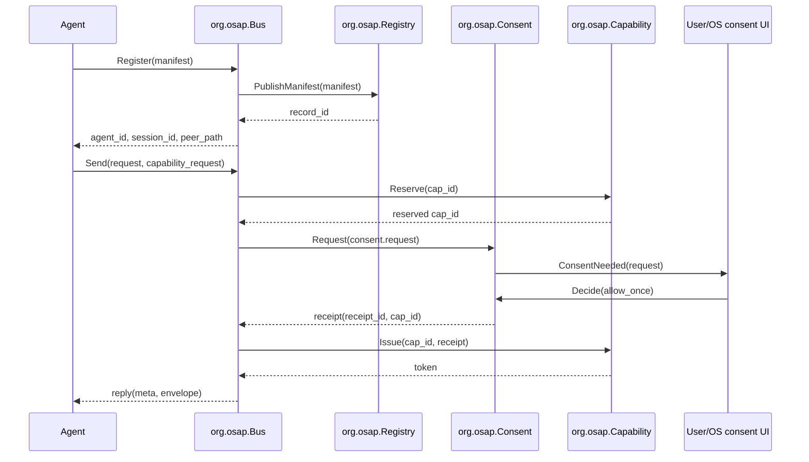
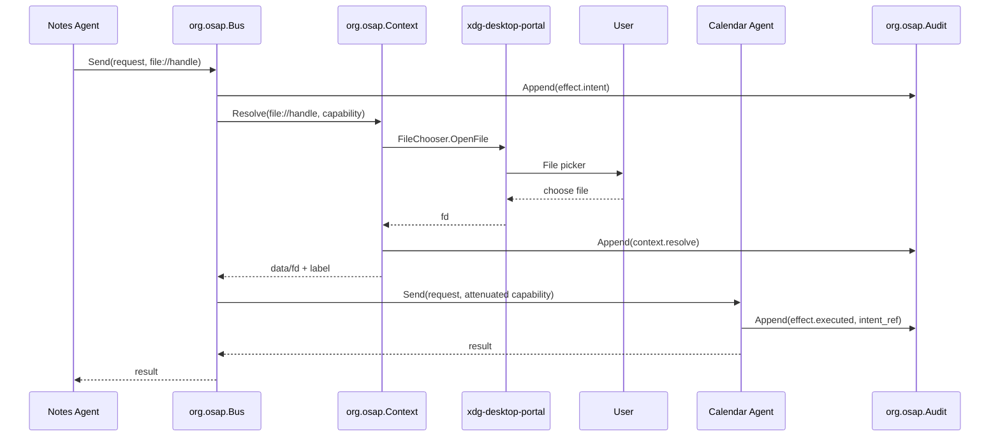
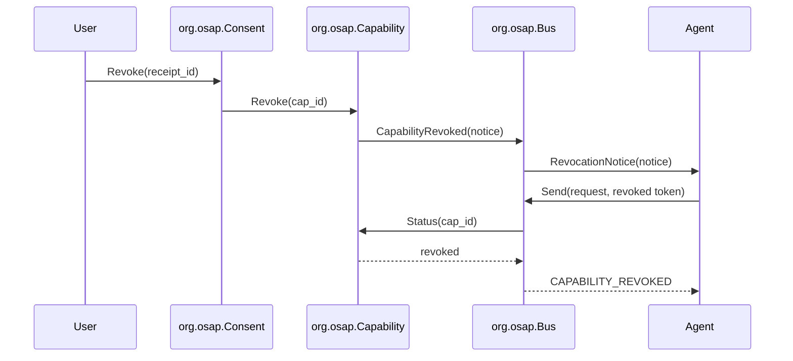

# OSAP Linux Binding Profile

> 状态：0.1 Draft · 2026-11-19
> 规范性来源：[`docs/standard.md`](../../docs/standard.md) §3.6、§7.10、§9、§10
> English version: [profile.en.md](profile.en.md)
> 范围：Linux 桌面、单用户会话、D-Bus 与 `systemd --user`

本文把 OSAP 映射到 Linux 桌面会话。它**不改变**协议语义，只规定消息如何经过 D-Bus、进程如何由 `systemd --user` 管理、以及 OSAP 的上下文句柄如何与 `xdg-desktop-portal` 对接。

本文不是 IETF 文档，也不要求所有 Linux 实现使用同一种传输。一个实现如果声明支持本 profile，MUST 满足第 2、3、5、6 节的 MUST 条款。

---

## 1. 角色与进程模型

### 1.1 进程

0.1 的 Linux binding 采用**每用户一个实例**的五个服务。它们由 `systemd --user` 拉起，运行在同一用户会话中，不跨用户共享。

| 服务 | D-Bus 名称 | 对象路径 | 职责 | 持久状态 |
|---|---|---|---|---|
| Bus Core | `org.osap.Bus` | `/org/osap/Bus` | 对端认证、信封校验、路由、连接/会话、背压 | 会话与任务索引可持久化 |
| Registry | `org.osap.Registry` | `/org/osap/Registry` | 清单、能力记录、事件主题、发现 | 清单与记录缓存 |
| Policy & Consent | `org.osap.Consent` | `/org/osap/Consent` | 策略求值、同意请求/回执、`cap_id` 预约 | 请求、回执、预约 |
| Capability Authority | `org.osap.Capability` | `/org/osap/Capability` | 签发、衰减、撤销、状态查询 | 已签发/已撤销能力 |
| Context Fabric | `org.osap.Context` | `/org/osap/Context` | 句柄解析、对象引用、portal 桥接 | 句柄、标签、事件 |
| Audit | `org.osap.Audit` | `/org/osap/Audit` | 只追加审计链、校验、导出、归档 | 审计链与归档 |

Bus Core MUST NOT 执行策略、签发能力、解析业务 payload 或持久化审计正文。Registry、Consent、Capability、Context、Audit MUST 作为独立进程或独立沙箱运行，不得与 Bus Core 共享地址空间。

### 1.2 D-Bus 名称与身份

- 服务 MUST 拥有上表的 well-known name；该名称只表示服务，不表示 Agent 身份。
- Agent 的 `agent://` URI MUST 由 Bus 在注册时分配或确认。D-Bus unique name（`:1.42`）MUST NOT 被当作 Agent 身份。
- Agent MAY 额外拥有 `org.osap.Agent.<app-id>.<instance>` 形式的名称用于调试，但该名称 MUST NOT 参与授权判断。
- Bus MUST 维护 `agent://` →（D-Bus unique name、pid、uid、可执行文件、会话）的绑定，并在每次路由时复核。

### 1.3 对象路径

固定服务对象使用上表的路径。动态对象使用 Bus 分配的十进制序号，避免把任意 `agent://` 字符串直接拼进对象路径：

- Peer：`/org/osap/Bus/Peers/<uint64>`
- Task：`/org/osap/Bus/Tasks/<uint64>`
- Stream：`/org/osap/Bus/Streams/<uint64>`

`<uint64>` MUST 在 Bus 生命周期内唯一；释放后 SHOULD 保留冷却期，避免旧消息误投。

---

## 2. 传输映射

### 2.1 会话总线与直连 socket

本 profile 定义两条路径：

1. **主路径：D-Bus session bus。** 所有服务在用户会话总线上注册。Agent 通过 D-Bus method call 调用服务。
2. **兼容路径：直连 Unix domain socket。** Bus MAY 在 `$XDG_RUNTIME_DIR/osap/bus.sock` 监听，供无法使用 D-Bus 的沙箱或运行时使用。直连 socket MUST `chmod 0600`，父目录 MUST `0700`。

两条路径 MUST 使用同一套 OSAP 信封、能力校验与审计逻辑。直连 socket 不是绕过 D-Bus 策略的“后门”；它 MUST 执行同样的对端认证与配额。

### 2.2 对端认证

- D-Bus 连接 MUST 使用 `EXTERNAL` 认证，MUST NOT 接受 `ANONYMOUS`。
- 服务 MUST 通过 `org.freedesktop.DBus.GetConnectionCredentials` 或等价的内核凭据读取 `uid`、`pid`，并校验 `uid == geteuid()`。跨 uid 调用 MUST 被拒绝。
- 服务 SHOULD 读取 `/proc/<pid>/exe` 或 `SO_PEERCRED` 的等价信息，把可执行文件路径纳入连接配额与审计。可执行文件路径 MUST NOT 被单独当作授权凭据。
- 直连 socket MUST 使用 `SO_PEERCRED`（Linux）或等价机制，并把 `uid`、`pid` 与 D-Bus 路径的规则对齐。

### 2.3 消息与流

D-Bus method call 是消息型传输，保留消息边界。OSAP 的 `stream` 语义通过文件描述符传递实现：

- **消息型**：`Send(a{sv} meta, ay envelope)`，`envelope` 是 UTF-8 JSON，无长度前缀。
- **流型**：`OpenStream(a{sv} meta, ay envelope) -> (h fd, s stream_id)`，返回的 `fd` 使用 OSAP 的 4 字节大端长度前缀分帧。
- 单条消息 MUST NOT 超过 8 MiB（含前缀，若为流）。D-Bus 自身可能先于 OSAP 拒绝过大的消息；服务 MUST 把 D-Bus 的 `org.freedesktop.DBus.Error.LimitsExceeded` 映射为 `TRANSPORT_FRAME_TOO_LARGE`。
- `fd` 只用于 `file://` 句柄、流或大对象；MUST NOT 用 `fd` 传递原始绝对路径。

### 2.4 JSON 编码

- `ay` 中的 JSON MUST 为 UTF-8、无 BOM、无尾随 NUL。
- `a{sv}` 只用于路由元数据与小控制消息；完整信封的权威表示是 `ay`。当两者冲突时，以 `ay` 为准，`a{sv}` 只作为提示。
- 服务 MUST 拒绝重复键、非整数数字和超出 8 MiB 的 `ay`。
- 业务 payload 的 `body.schema` 校验由接收方执行；Bus 只校验信封。

### 2.5 D-Bus 策略

会话总线策略 MUST 限制 `org.osap.*` 的调用者与当前 uid 相同，并禁止 eavesdrop。示例：

```xml
<!DOCTYPE busconfig PUBLIC "-//freedesktop//DTD D-BUS Bus Configuration 1.0//EN"
 "http://www.freedesktop.org/standards/dbus/1.0/busconfig.dtd">
<busconfig>
  <policy user="current">
    <allow own="org.osap.Bus"/>
    <allow own="org.osap.Registry"/>
    <allow own="org.osap.Consent"/>
    <allow own="org.osap.Capability"/>
    <allow own="org.osap.Context"/>
    <allow own="org.osap.Audit"/>
    <allow send_destination="org.osap.Bus"/>
    <allow send_destination="org.osap.Registry"/>
    <allow send_destination="org.osap.Consent"/>
    <allow send_destination="org.osap.Capability"/>
    <allow send_destination="org.osap.Context"/>
    <allow send_destination="org.osap.Audit"/>
  </policy>
  <policy context="default">
    <deny eavesdrop="true"/>
    <deny send_destination="org.osap.Bus"/>
    <deny send_destination="org.osap.Registry"/>
    <deny send_destination="org.osap.Consent"/>
    <deny send_destination="org.osap.Capability"/>
    <deny send_destination="org.osap.Context"/>
    <deny send_destination="org.osap.Audit"/>
  </policy>
</busconfig>
```

不同发行版的默认策略可能不同。实现 MUST 在安装时验证：不同 uid 的进程不能调用 `org.osap.*`，且不能 eavesdrop。

---

## 3. D-Bus 接口

### 3.1 `org.osap.Bus`

```text
interface org.osap.Bus {
  Register(a{sv} manifest) -> (s agent_id, s session_id, o peer_path);
  Unregister(s agent_id) -> ();
  Send(a{sv} meta, ay envelope) -> (a{sv} reply_meta, ay reply_envelope);
  OpenStream(a{sv} meta, ay envelope) -> (h fd, s stream_id);
  Cancel(s task_id, s reason) -> ();
  GetTask(s task_id) -> (a{sv} task);
  ListPeers() -> (aa{sv} peers);

  signal MessageDelivered(a{sv} meta, ay envelope);
  signal TaskStateChanged(a{sv} task);
  signal RevocationNotice(a{sv} notice);
  signal ConsentRequested(a{sv} request);
  signal PeerDisconnected(s agent_id, s reason);
}
```

- `Register` MUST 验证清单签名、保留命名空间、公钥绑定与 `session_id`，失败按 `docs/standard.md` §4.4 的顺序返回 `AUTH_DENIED`。
- `Send` MUST 先校验信封版本、消息类型、JSON Schema 与能力绑定，再路由。返回的 `reply_meta` MUST 包含 `trace_id`、`message_id`、`decision`。
- `OpenStream` 的 `fd` MUST 在失败时关闭，MUST NOT 泄漏给未授权调用者。
- `Cancel` MUST 沿任务树传播；`detached=true` 的子树 MAY 继续运行，但 MUST 失去父能力。
- `RevocationNotice` 与 `ConsentRequested` 是通知信号，不构成授权；接收方 MUST 在执行前重新检查能力/回执状态。

### 3.2 `org.osap.Registry`

```text
interface org.osap.Registry {
  PublishManifest(a{sv} manifest) -> (s record_id);
  Lookup(s cap, a{sv} query) -> (aa{sv} records);
  Watch(as caps) -> (u subscription);
  Unwatch(u subscription) -> ();

  signal RecordsChanged(aa{sv} records);
}
```

- `PublishManifest` MUST 验证签名后才索引；失败返回 `AUTH_DENIED`，不得部分写入。
- `Lookup` 的结果 MUST 带 `observed_at` 与 `expires_at`；过期记录 MUST NOT 用于授权决策。
- `Watch` 只通知记录变化，不授予能力；订阅者 MUST 在解析后重新做能力与出口检查。
- 能力记录的 `risk` 与 `consent` 字段 MUST 按 `docs/standard.md` §6.2 归一；PCS 可以提升风险，不能降低。

### 3.3 `org.osap.Consent`

```text
interface org.osap.Consent {
  Request(a{sv} request) -> (s request_id);
  Decide(s request_id, s decision, a{sv} constraints) -> (a{sv} receipt);
  Revoke(s receipt_id, s reason) -> ();
  GetReceipt(s receipt_id) -> (a{sv} receipt);

  signal ConsentNeeded(a{sv} request);
}
```

- `Request` MUST 校验 `request_id`、`task_id`、`agent`、`audience`、`actions`、`resources`、`risk`、`intent_preview` 与 `options`；缺失或伪造的字段 MUST 被拒绝。
- `Decide` 只接受 `request` 中提供的选项；`allow_once` MUST 产生 `max_uses=1`；回执过期时间 MUST 不超过请求的 `expires_at`。
- `Revoke` MUST 级联到引用该回执的能力与子能力，并写入审计。重复撤销 MUST 幂等。
- `ConsentNeeded` 只用于通知 UI；用户决策 MUST 通过 `Decide` 返回，不得用信号代替。

### 3.4 `org.osap.Capability`

```text
interface org.osap.Capability {
  Issue(a{sv} request) -> (a{sv} token);
  Attenuate(a{sv} parent, a{sv} child) -> (a{sv} token);
  Revoke(s cap_id, s reason) -> ();
  Status(s cap_id) -> (s status);

  signal CapabilityRevoked(a{sv} notice);
}
```

- `Issue` MUST 支持 §10.3 的预约顺序：先 `Reserve`（可由 `Issue` 的内部实现完成），再验回执，再激活。未激活的 `cap_id` MUST NOT 通过任何路由校验。
- `Attenuate` MUST 执行 §5.3 的全部 10 条规则；任一条失败 MUST 返回 `CAPABILITY_ATTENUATION_INVALID`。
- `Status` 返回值 MUST 为 `active`、`revoked`、`expired` 或 `unknown`。`unknown` MUST 被接收方视为拒绝（fail closed）。
- `Revoke` MUST 级联到所有后代；重复撤销 MUST 返回成功且不重复写审计。

### 3.5 `org.osap.Context`

```text
interface org.osap.Context {
  CreateHandle(a{sv} spec) -> (s handle);
  Resolve(s handle, a{sv} capability, a{sv} options) -> (a{sv} result);
  OpenFile(s handle, a{sv} capability) -> (h fd);
  RevokeHandle(s handle) -> ();
}
```

- `CreateHandle` MUST 只接受 `ctx://`、`obj://`、`task://`、`file://`、`contact://`、`event://` 方案；`file://` MUST 是不透明句柄，不得包含绝对路径。
- `Resolve` MUST 校验 `resolve` 动作、`audience`、`task_id`、`subject`、`exp` 与信息流标签；失败返回 `CONTEXT_DENIED` 或 `CONTEXT_NOT_FOUND`，不得泄漏存在性以外的信息。
- `OpenFile` MUST 返回 `O_CLOEXEC` 的 `fd`，并校验 `fstat` 不是目录、不是设备（除非能力显式允许）。调用者关闭 `fd` 后句柄仍然有效，但再次打开 MUST 重新过策略。
- `RevokeHandle` MUST 使所有派生句柄失效，并写入 `context.resolve`/撤销审计。

### 3.6 `org.osap.Audit`

```text
interface org.osap.Audit {
  Append(a{sv} event) -> (s audit_id, s hash);
  Verify(s trace_id) -> (b ok, s reason);
  History(s trace_id, u limit) -> (aa{sv} events);
  Export(s trace_id, a{sv} options) -> (ay export);
}
```

- `Append` MUST 在 L3/L4 副作用前可写；写入失败 MUST 阻止副作用（`AUDIT_UNAVAILABLE` 扩展码）。
- `Verify` MUST 校验 schema、phase 规则、trace 一致性、`audit_id` 唯一性与 `prev_hash` 链接；校验失败返回 `AUDIT_CHAIN_INVALID`。
- `History` 返回归档 + live 的顺序视图；`limit` 只限制返回条数，不改变链。
- `Export` 的脱敏 MUST 使用每次导出唯一的盐值；验证方 MUST 知道脱敏限制，不得把承诺当作明文。

### 3.7 属性

| 接口 | 属性 | 类型 | 说明 |
|---|---|---|---|
| `org.osap.Bus` | `ProtocolVersion` | `s` | OSAP wire version，0.1 为 `0.1` |
| `org.osap.Bus` | `SessionId` | `s` | 当前会话标识 |
| `org.osap.Bus` | `MaxMessageBytes` | `u` | 8 MiB 上限 |
| `org.osap.Capability` | `SupportedProfiles` | `as` | `["P0"]`；0.1 MUST NOT 声称 P1 |
| `org.osap.Audit` | `GenesisHash` | `s` | 当前 trace 的创世哈希 |

---

## 4. 错误映射

D-Bus 错误名 MUST 使用 `org.osap.Error.<CODE>`，其中 `<CODE>` 与 `docs/standard.md` §7.7 的标准错误码一致。错误消息的第一个参数 SHOULD 是 `a{sv}`，包含 `code`、`message`、`retryable` 与 `details`。

| OSAP 错误码 | D-Bus 错误名 | 备注 |
|---|---|---|
| `AUTH_DENIED` | `org.osap.Error.AUTH_DENIED` | 对端认证、签名、注册拒绝 |
| `SCHEMA_INVALID` | `org.osap.Error.SCHEMA_INVALID` | `body.data` 或信封结构错误 |
| `ROUTING_NOT_FOUND` | `org.osap.Error.ROUTING_NOT_FOUND` | 目标 Agent/能力不存在 |
| `ROUTING_AMBIGUOUS` | `org.osap.Error.ROUTING_AMBIGUOUS` | 能力解析不唯一 |
| `CAPABILITY_AUDIENCE_MISMATCH` | `org.osap.Error.CAPABILITY_AUDIENCE_MISMATCH` | audience 与接收方不一致 |
| `CAPABILITY_SUBJECT_MISMATCH` | `org.osap.Error.CAPABILITY_SUBJECT_MISMATCH` | subject 与 from 不一致 |
| `CAPABILITY_TASK_MISMATCH` | `org.osap.Error.CAPABILITY_TASK_MISMATCH` | task_id 与信封不一致 |
| `CAPABILITY_REVOKED` | `org.osap.Error.CAPABILITY_REVOKED` | 已撤销或过期 |
| `POLICY_DENIED` | `org.osap.Error.POLICY_DENIED` | 策略拒绝 |
| `POLICY_CONSENT_REQUIRED` | `org.osap.Error.POLICY_CONSENT_REQUIRED` | 缺少同意回执 |
| `POLICY_CONSENT_EXPIRED` | `org.osap.Error.POLICY_CONSENT_EXPIRED` | 回执过期/撤销 |
| `POLICY_CONSENT_SCOPE_MISMATCH` | `org.osap.Error.POLICY_CONSENT_SCOPE_MISMATCH` | 回执范围不足 |
| `TASK_BUDGET_EXCEEDED` | `org.osap.Error.TASK_BUDGET_EXCEEDED` | 预算耗尽 |
| `CONTEXT_DENIED` | `org.osap.Error.CONTEXT_DENIED` | 无权限解析 |
| `CONTEXT_EXPIRED` | `org.osap.Error.CONTEXT_EXPIRED` | 句柄过期 |
| `CONTEXT_NOT_FOUND` | `org.osap.Error.CONTEXT_NOT_FOUND` | 句柄不存在 |
| `RATE_LIMIT` | `org.osap.Error.RATE_LIMIT` | 配额/速率 |
| `TIMEOUT` | `org.osap.Error.TIMEOUT` | deadline |
| `CANCELLED` | `org.osap.Error.CANCELLED` | 取消 |
| `INTERNAL` | `org.osap.Error.INTERNAL` | 内部错误 |

D-Bus 自身的 `org.freedesktop.DBus.Error.AccessDenied` MUST 映射为 `AUTH_DENIED`；`org.freedesktop.DBus.Error.LimitsExceeded` MUST 映射为 `TRANSPORT_FRAME_TOO_LARGE`；`org.freedesktop.DBus.Error.NoReply` MUST 映射为 `TIMEOUT`。映射 MUST 保留原始错误名到 `details.dbus_error`。

---

## 5. 与 `xdg-desktop-portal` 的映射

`xdg-desktop-portal` 是沙箱应用访问文件、屏幕、通知等资源的用户中介。OSAP 不复制 portal 的 UI，而是把 portal 的**一次性选择结果**包装成受 TTL 与标签约束的 OSAP 句柄。

### 5.1 映射表

| OSAP 能力/句柄 | portal 接口 | 结果 | OSAP 处理 |
|---|---|---|---|
| `cap://os/file/read` + `file://` | `org.freedesktop.portal.FileChooser.OpenFile` | `fd` 或 URI | 包装为不透明 `file://` 句柄，TTL=任务/会话 |
| `cap://os/file/save` + `file://` | `org.freedesktop.portal.FileChooser.SaveFile` | `fd` 或 URI | 同上；写入动作单独授权 |
| `cap://os/uri/open` | `org.freedesktop.portal.OpenURI.OpenURI` | 无 | 记录 `context.resolve`/`effect.intent` |
| `cap://os/notification` | `org.freedesktop.portal.Notification.AddNotification` | 无 | L2；记录审计，不提升为 L3 |
| `cap://os/screenshot` | `org.freedesktop.portal.Screenshot` | URI/`fd` | 包装为 `obj://`，标签 `sensitive` |
| `cap://os/screencast` | `org.freedesktop.portal.ScreenCast` | `fd` + node id | 包装为流；会话结束撤销 |
| `cap://os/secrets` | `org.freedesktop.portal.Secret.RetrieveSecret` | `ay` | 只返回给持有 `secrets.read` 的 Agent；不落盘 |
| `cap://os/background` | `org.freedesktop.portal.Background` | 无 | 只用于 autostart，不作为动作授权 |
| `cap://os/device` | `org.freedesktop.portal.Device` | `fd` | 按设备类收窄；无通用设备能力 |
| `cap://os/clipboard` | 无标准 portal | — | 0.1 不定义；实现 MUST NOT 用 portal 授予环境权限 |
| `cap://os/contacts` | 无标准 portal | — | 由应用能力提供；不得用 portal 绕过 |
| `cap://os/calendar` | 无标准 portal | — | 由应用能力提供；不得用 portal 绕过 |
| `cap://os/messages` | 无标准 portal | — | 由应用能力提供；不得用 portal 绕过 |

### 5.2 规则

- portal 的返回值是**资源选择结果**，不是 OSAP 能力。它 MUST 被包装成带 `ttl`、`label`、`origin` 的句柄，并由 OSAP 能力控制后续解析。
- portal 的 UI 决策 MUST 记录为 `context.resolve` 审计；如果该动作同时是 L3/L4，MUST 另有 `consent.granted`/`consent.requested` 事件与回执。
- portal 请求句柄（`request_handle`）MUST NOT 直接传给 Agent；它只在 Context Fabric 内部使用。
- portal 返回的 URI MUST NOT 被当作 `file://` 句柄；Context Fabric MUST 重新包装，避免路径泄漏。
- portal 不可用时，相关能力 MUST fail closed；实现 MUST NOT 回退到直接路径访问。
- Flatpak/Snap 应用 SHOULD 通过 portal 访问资源；授予 `--socket=session-bus` 或 `--filesystem=home` 会扩大攻击面，不应作为 OSAP 的默认安装方式。

---

## 6. `systemd --user` 与 socket activation

### 6.1 单元

示例单元位于 [`units/`](units/)。安装时复制到 `~/.config/systemd/user/`，然后执行：

```bash
systemctl --user daemon-reload
systemctl --user enable --now osap-bus.socket
systemctl --user enable --now osap-registry.service
systemctl --user enable --now osap-consent.service
systemctl --user enable --now osap-capability.service
systemctl --user enable --now osap-context.service
systemctl --user enable --now osap-audit.service
```

- `osap-bus.socket` MUST 监听 `%t/osap/bus.sock`，`SocketMode=0600`，`DirectoryMode=0700`。
- `osap-bus.service` MUST 设置 `BusName=org.osap.Bus`，`Sockets=osap-bus.socket`，并在 `ExecStart` 中接收 `--socket=%t/osap/bus.sock`。
- 辅助服务 MUST 设置 `BusName=org.osap.<Service>`，`After=osap-bus.service`，`Requires=osap-bus.service`。它们 MAY 由 D-Bus 激活或由 systemd 直接启动；同一发行版 MUST 只选择一种激活路径，避免双启动。
- 所有服务 MUST 设置 `NoNewPrivileges=yes`、`PrivateTmp=yes`、`ProtectSystem=strict`、`ProtectHome=read-only` 或更严格、`RestrictAddressFamilies=AF_UNIX`、`CapabilityBoundingSet=`、`DevicePolicy=closed`、`UMask=0077`。
- Audit 与 Context 需要 `StateDirectory=osap` 或独立状态目录；MUST `0700`。Bus 的运行时目录 MUST 使用 `RuntimeDirectory=osap`，`RuntimeDirectoryMode=0700`。

### 6.2 D-Bus activation

不使用 systemd 的会话可以提供 D-Bus service 文件：

```ini
[D-BUS Service]
Name=org.osap.Bus
Exec=/usr/libexec/osap-bus
SystemdService=osap-bus.service
```

如果同名的 systemd user unit 已设置 `BusName=org.osap.Bus`，D-Bus activation MUST NOT 与 `osap-bus.socket` 同时启用；否则可能出现两个 Bus 实例。安装脚本 SHOULD 检查 `systemctl --user is-enabled osap-bus.socket`，并在启用 socket activation 时移除 D-Bus service 文件，或反之。

### 6.3 直连 socket 的生命周期

- `osap-bus.socket` 由 systemd 持有；Bus 崩溃后 socket 仍存在，下一次连接会重新拉起服务。
- Bus MUST 在启动时清理过期的 peer/task/stream 对象，并按 §3.7 恢复会话与任务索引。
- `RemoveOnStop=yes` SHOULD 用于开发环境；生产环境可保留 socket 文件，但 MUST 确保 `0700` 父目录。

---

## 7. 序列图

### 7.1 注册与带同意的能力签发



### 7.2 跨应用请求、portal 句柄与两段审计



### 7.3 撤销与执行前检查



---

## 8. 一致性与测试

本 profile 不新增测试编号；`docs/conformance.md` 仍是唯一来源。Linux 实现至少应覆盖：

| 检查 | 对应用例 |
|---|---|
| 不同 uid 不能调用 `org.osap.*`；eavesdrop 被拒绝 | C0 传输与 C1 身份 |
| `Send` 拒绝 `from` 与 D-Bus 凭据不一致 | C1-02、C1-05 |
| `Send` 拒绝 audience/task/subject 绑定错误 | C3 授权 |
| `OpenStream` 使用 4 字节大端长度前缀，单帧 ≤ 8 MiB | C0 传输 |
| 回执预约未激活时不能通过路由 | C4 协作 |
| 撤销后执行前检查返回 `CAPABILITY_REVOKED` | C3/C7 |
| portal 结果被包装为 `file://` 句柄，不泄漏路径 | C5 上下文 |
| 审计链在 D-Bus 重启后仍可验证 | C7 审计 |

在 `docs/conformance.md` 增加 Linux-specific 用例之前，上表是**实现检查清单**，不是新的一致性等级。CI 的 `tools/check_drafts.py` 不依赖 D-Bus；D-Bus 集成测试应在 Linux 桌面上用 `dbus-run-session` 单独运行。

---

## 9. 安全考虑

- **同 uid 不等于可信。** 同一用户的任意进程都可能调用会话总线。OSAP 仍 MUST 做对端认证、能力绑定与审计，不能把 uid 当作授权。
- **D-Bus 不提供机密性。** 会话总线上的 payload 对同 uid 进程可见（在策略允许时）。敏感数据 SHOULD 以 `obj://`/`file://` 句柄传递，必要时用 `fd` 或端到端加密。
- **payload 可见性。** Bus MUST NOT 解析业务 payload；需要隐藏 payload 的部署应等待 0.2 的 P1 profile。
- **Flatpak/Snap。** 沙箱应用可能只能访问 portal；MUST NOT 通过放宽沙箱权限来“修复”连接问题。应使用 portal 与 `--talk-name=org.osap.Bus` 的最小权限。
- **FD 传递。** 校验 `fd` 类型、`O_CLOEXEC`、`fstat` 与 `O_NOFOLLOW`；失败时关闭所有已传递的 `fd`。
- **systemd 硬化。** `SystemCallFilter=@system-service` 与 `ProtectHome` 可能影响某些发行版或文件句柄；部署 MUST 在目标发行版上测试，并在失败时收窄而不是移除硬化。
- **审计可用性。** L3/L4 动作在审计不可写时 MUST 拒绝；不得用“先执行后补审计”绕过。

---

## 10. 引用

- [OSAP 0.1 规范](../../docs/standard.md)：§3.6 组件、§7.10 传输绑定、§9 Context Fabric、§10 同意与审计。
- [D-Bus Specification](https://dbus.freedesktop.org/doc/dbus-specification.html)：消息类型、`EXTERNAL` 认证、`GetConnectionCredentials`、错误模型。
- [xdg-desktop-portal](https://flatpak.github.io/xdg-desktop-portal/)：FileChooser、OpenURI、Notification、Screenshot、ScreenCast、Secret、Device。
- [systemd.exec](https://www.freedesktop.org/software/systemd/man/systemd.exec.html)、[systemd.socket](https://www.freedesktop.org/software/systemd/man/systemd.socket.html)、[systemd.service](https://www.freedesktop.org/software/systemd/man/systemd.service.html)：用户单元、socket activation、沙箱选项。
- [Flatpak sandbox permissions](https://docs.flatpak.org/en/latest/sandbox-permissions.html)：portal 与 `--talk-name` 的权限模型。
